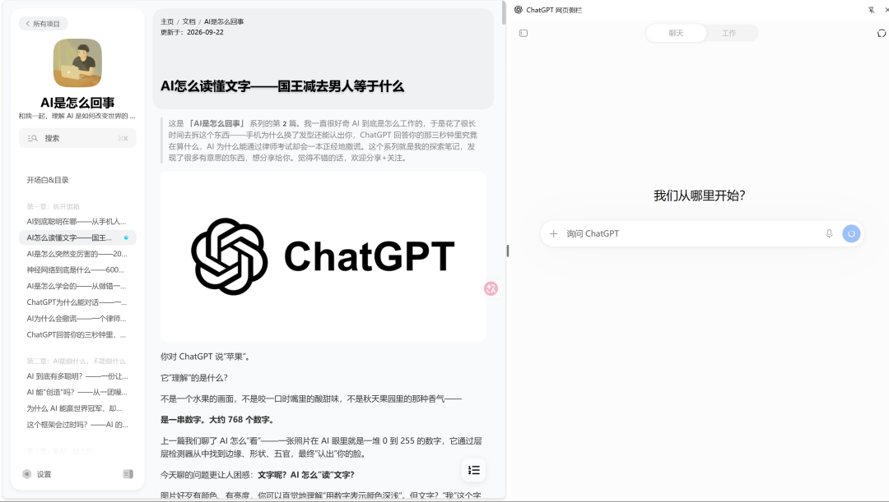

# ChatGPT Sidebar for Chrome · Chrome 网页侧栏

[中文](#中文) · [English](#english)



## 中文

在 Chrome 侧栏使用 ChatGPT，快捷传入当前网页链接和选中文字，继续上次对话。使用自己的 ChatGPT 账号。

第三方独立扩展，与 OpenAI 无关联。当前版本为预发布，ChatGPT 页面更新可能影响兼容性。

### 安装

**[下载发行包](https://github.com/SANG4242/chatgpt-chrome-sidepanel/releases)**：打开最新版本，下载 `chatgpt-chrome-sidepanel-v版本号.zip`。

1. 解压 ZIP，保留文件夹。
2. 在 Chrome 地址栏输入 `chrome://extensions`，开启右上角的 **开发者模式**。
3. 点击 **加载已解压的扩展程序**，选择包含 `manifest.json` 的文件夹。

将扩展固定到工具栏。先在同一 Chrome 用户配置中登录 [ChatGPT](https://chatgpt.com/)，再打开侧栏。

### 使用

| 操作 | 功能 |
| --- | --- |
| 点击扩展图标 / `Ctrl+G` | 打开或收起侧栏，继续上次对话 |
| `Alt+G` | 打开侧栏，将当前网页链接追加到输入框 |
| `Ctrl+Shift+G` | 新建对话，清空当前侧栏草稿 |
| 选中文字 → 点击「问问 ChatGPT」 | 将页面链接和选中文字追加到输入框 |

链接和选中文字追加到草稿，**由你确认后发送**。普通开关恢复本次 Chrome 会话中的对话地址和文字草稿，恢复范围限于这两项。退出 Chrome、停用或重新加载扩展会结束恢复缓存。

快捷键有冲突时，在 `chrome://extensions/shortcuts` 设置。新对话快捷键也可以改为 `Alt+Shift+G`。要把侧栏放在右边，在 `chrome://settings/appearance` 的侧栏设置中选择右侧显示。

### 更新与排错

- **更新**：关闭侧栏，将新版文件覆盖到原安装文件夹，在 `chrome://extensions` 点击重新加载，再刷新普通网页。后续版本采用相同的手动更新步骤。
- **划词按钮未出现**：确认扩展的网站访问权限为「在所有网站上」，刷新页面后重新选中文字。划词适用于普通网页正文；部分网站可能有兼容问题。
- **ChatGPT 空白或验证循环**：在普通标签页完成登录或验证，再关闭重开侧栏。
- **链接无法读取**：ChatGPT 需要能够访问目标链接，登录页面和内网页面可能受限。

### 权限与安全

- HTTP/HTTPS 网站访问权限用于显示划词按钮；选区在本机检测，点击按钮后才传入链接和文字。`Alt+G` 传入当前链接。
- 登录态由 Chrome 管理。扩展的数据处理范围为当前链接、用户点击传入的选中文字及侧栏恢复信息；填入 ChatGPT 的内容受 ChatGPT 自身的数据处理规则约束。
- 待填内容和侧栏恢复状态保存在本机的 `chrome.storage.session` 中。待填内容成功填入后删除，有效期五分钟。
- 为支持嵌入，扩展移除由本扩展发起的 ChatGPT 内嵌页面响应中的 `X-Frame-Options` 和整个 `Content-Security-Policy`。这会减少该内嵌页面的浏览器端安全保护，处理范围限定于此类请求。
- 网页链接可能包含私密参数，发送前请检查草稿。

### 开发

Node.js 18+、Python 3.9+。

```sh
npm run check
npm test
npm run build
```

发行 ZIP 输出到 `dist/`。

可选浏览器验收：先安装 Playwright 和可加载扩展的测试 Chromium，再设置 `PLAYWRIGHT_ROOT` 为 Playwright 包的绝对路径、`TEST_CHROME` 为浏览器可执行文件路径，运行 `node tests/browser-check.cjs`。此测试使用模拟网页。

## English

Use ChatGPT in Chrome’s side panel. Add the current page URL or selected text with a shortcut, and resume your last conversation. Uses your own ChatGPT account.

An independent third-party extension, not affiliated with OpenAI. The current version is a prerelease. Changes to the ChatGPT website may affect compatibility.

### Install

**[Download a release](https://github.com/SANG4242/chatgpt-chrome-sidepanel/releases)**: open the newest version and download `chatgpt-chrome-sidepanel-vVERSION.zip`.

1. Extract the ZIP and keep the folder.
2. Open `chrome://extensions` and enable **Developer mode**.
3. Select **Load unpacked** and choose the folder containing `manifest.json`.

Pin the extension to the toolbar. Sign in to [ChatGPT](https://chatgpt.com/) in a regular tab using the same Chrome profile, then open the side panel.

### Use

| Action | Result |
| --- | --- |
| Toolbar icon / `Ctrl+G` | Open or close the panel; continue the previous conversation |
| `Alt+G` | Open the panel and append the current page URL to the composer |
| `Ctrl+Shift+G` | Start a new chat and clear the current panel draft |
| Select text → click “问问 ChatGPT” | Append the page URL and selected text to the composer |

Links and selected text are added to the draft for **you to review and send**. Reopening restores the conversation URL and text draft within the current Chrome session; restoration covers these two items. Closing Chrome, disabling, or reloading the extension clears the restore cache.

Set shortcuts at `chrome://extensions/shortcuts` if they conflict. You can change the new-chat shortcut to `Alt+Shift+G`. Choose the right-hand side panel position in `chrome://settings/appearance`.

### Update and troubleshoot

- **Update**: close the panel, replace the files in the existing installation folder, reload the extension at `chrome://extensions`, and refresh regular web pages. Use the same manual steps for future updates.
- **Selection button missing**: allow site access on all sites, refresh the page, and select text again. Selection works on regular web page text; some sites may have compatibility issues.
- **Blank page or verification loop**: complete sign-in or verification in a regular ChatGPT tab, then reopen the panel.
- **ChatGPT cannot read a link**: ChatGPT needs access to the target URL. Signed-in pages and intranet pages may be restricted.

### Permissions and security

- HTTP/HTTPS site access is used for the selection button. Selections are detected locally; their URL and text are passed only when you click the button. `Alt+G` passes the current URL.
- Chrome manages the sign-in session. The extension handles the current URL, selected text you choose to pass, and panel restore data. Content entered into ChatGPT is subject to ChatGPT's own data handling practices.
- Pending text and panel state are kept locally in `chrome.storage.session`. Pending text is removed after insertion and expires after five minutes.
- To embed ChatGPT, the extension removes `X-Frame-Options` and the entire `Content-Security-Policy` header from ChatGPT subframe responses initiated by this extension. This reduces browser-side protections for that embedded page; processing is limited to those requests.
- URLs may contain private parameters. Review the draft before sending.

### Development

Node.js 18+ and Python 3.9+.

```sh
npm run check
npm test
npm run build
```

The ZIP is written to `dist/`.

For optional browser checks, install Playwright and a test Chromium that supports extension loading. Set `PLAYWRIGHT_ROOT` to the absolute Playwright package directory and `TEST_CHROME` to the browser executable, then run `node tests/browser-check.cjs`. These tests use mock pages.

## License

Project code: [MIT](LICENSE). Icon attribution and license: [THIRD_PARTY_NOTICES.txt](THIRD_PARTY_NOTICES.txt). OpenAI and ChatGPT names and marks belong to their respective owners; the software license does not grant trademark rights.
